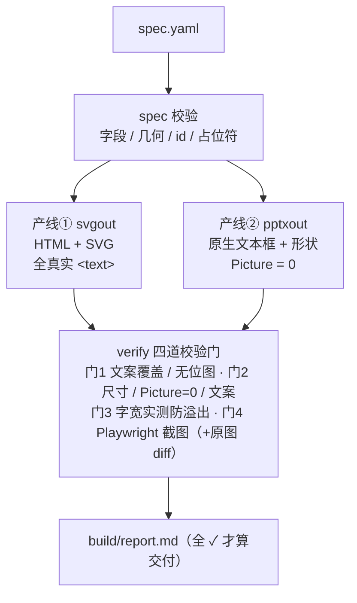

# Snap2Edit · 截图复刻引擎

> **把一张静态图表"复活"为两份完全可编辑的交付物：HTML+SVG 与原生 PPTX。**
> 一份布局规格（spec），双产线同步渲染，四道校验门自动把关。

| | |
|---|---|
| 版本 | v0.2.0（引擎 + 案例库 + Web 框架骨架） |
| 语言 | Python ≥ 3.9 |
| 协议 | MIT |
| 状态 | 活跃开发（PRD 见 `docs/PRD.md`） |

---

## 为什么做（背景）

把参考图/截图还原成可编辑文件（HTML、PPT）是咨询、方案、内容创作的高频工作。
此前我们用一套**六步标准流程**手工完成了多张信息图的高保真复刻（见 `docs/WORKFLOW.md`），
验证了方法可复现，但也暴露了四大痛点：

1. **双产物靠人肉同步** —— 同一份布局要写两遍（SVG 一遍、python-pptx 一遍），改一处动两处；
2. **校验靠肉眼** —— 文案覆盖、无位图、无嵌入图片、文本溢出，全靠人工盯；
3. **经验难沉淀** —— 坐标换算公式、中文字体双保险、关阴影等十几条经验散落在一次性脚本里；
4. **无法规模化** —— 每张图从零开始，没有脚手架、没有组件库。

**Snap2Edit 把这套流程产品化**：人（或 AI）负责唯一需要智能的环节——"看图写规格书"，
其余全部工具化、自动化、可校验。

## 核心特性

- 📝 **规格书驱动**：一份 YAML（坐标 + 色板 + 文案 + 元素），是两条产线的唯一事实源；
- 🔁 **双产线同源渲染**：`spec.yaml` → ① 全真实文本、带 id 独立单元、零位图的 HTML+SVG；
  ② 100% 原生文本框+形状（Picture=0）的 PPTX；
- ✅ **四道校验门**：文案覆盖 / 无位图 / 无 Picture / 文本边界实测防溢出 / 截图非空白；
- 🧩 **组件化元素**：`rect / rrect / pill / text / line / arrow`，箭头自动拆为线段+三角独立单元；
- 🀄 **中文双保险**：自动补 `a:ea`/`a:cs` 东亚字体、PIL 实测字宽、坐标/字号换算公式内置；
- 🖥️ **一条命令**：`build` 双渲染，`check` 出校验报告（Markdown）。

## 快速开始

```bash
# 安装（开发模式）
pip install -e .
# 可选：启用截图校验门
pip install playwright && playwright install chromium

# 1) 生成规格书模板
snap2edit new my-project
# 2) 编辑 my-project/spec.yaml 后，一键双渲染
snap2edit build my-project
# 3) 四道校验门 + 报告
snap2edit check my-project [--original 原图.png]
```

## 测试与覆盖率

```bash
# 引擎（pytest + coverage，Playwright 截图门真实执行）
python -m coverage run -m pytest tests/ -q
python -m coverage report          # 当前 ≈99%（.coveragerc 开启 greenlet 并发追踪）

# Web 纯逻辑单测（Node ≥24 原生跑 TS，无需编译）
cd web && npm test                 # node --test tests/*.test.ts
npm run test:cov                   # 附 V8 覆盖率报告（当前 100% 行覆盖）
```

或者直接体验自带 demo（本仓库已含构建产物）：

```bash
python -m snap2edit build examples/demo
python -m snap2edit check examples/demo
```

产出：`examples/demo/build/snap2edit-demo.html`、`snap2edit-demo.pptx`、`shot.png`、`report.md`。

## 工作原理

```
                 ┌────────────────────────────────┐
  spec.yaml ────▶│  spec 校验（字段/几何/id/占位符）│
                 └───────────┬────────────────────┘
              ┌──────────────┴──────────────┐
              ▼                             ▼
   ┌──────────────────┐          ┌──────────────────┐
   │ 产线① svgout     │          │ 产线② pptxout    │
   │ HTML + SVG       │          │ 原生文本框+形状   │
   │ 全真实 <text>    │          │ Picture = 0      │
   └────────┬─────────┘          └────────┬─────────┘
            ▼                             ▼
   ┌─────────────────────────────────────────────────┐
   │ verify 四道校验门                                │
   │ 门1 文案覆盖/无位图 · 门2 尺寸/Picture=0/文案    │
   │ 门3 字宽实测防溢出 · 门4 Playwright截图(+原图diff)│
   └────────────────────┬────────────────────────────┘
                        ▼
              build/report.md（全 ✓ 才算交付）
```

**Mermaid 版**（GitHub 原生渲染；与上图同构，供交互式查看与复制改画）：



## 与六步标准流程的映射

| 流程结点 | Snap2Edit 承接方式 |
|---|---|
| N1 原图分析→规格书 | 人工/LLM 编写 `spec.yaml`（v2 计划 AI 辅助生成，见 PRD F8） |
| N2 HTML+SVG 生成 | `snap2edit build` 产线①，结点校验进入门1 |
| N3 截图对比收敛 | `check` 门4（截图/非空白/可选原图块差异） |
| N4 PPTX 原生生成 | `snap2edit build` 产线②，结点校验进入门2 |
| N5 版式校验 | 门3 文本边界实测（ soffice 渲染留作 CI 扩展） |
| N6 终检 | 门1/门2 的文案清单、占位符黑名单断言 + `report.md` |

## 元素类型速查（v0）

| type | 几何字段 | 专属属性 | 说明 |
|---|---|---|---|
| `rect` | x y w h | fill / stroke / stroke_width / rotate | 矩形 |
| `rrect` | x y w h | rx / rotate | 圆角矩形 |
| `pill` | x y w h | rotate | 胶囊（rx=h/2） |
| `circle` | x y w h | fill / stroke / stroke_width / rotate | 椭圆（内切于包围盒） |
| `text` | x y (w 可选) | size / bold / color / align / lines / line_height / rotate | 自由文本 |
| `line` | x1 y1 x2 y2 | stroke / stroke_width | 直线 |
| `arrow` | x1 y1 x2 y2 | stroke / stroke_width / head | 箭头（线段+三角两个单元） |

带 `text`+`size` 的盒子类型会自动渲染居中文字（PPTX 侧为独立文本框）。
`rotate`（v0.2.1+，可选）：度、顺时针；盒子绕自身中心、自由文本绕锚点，双产线同语义
（SVG `transform=rotate` ⇄ PPTX `rotation` + 文本框重定位）；线段/箭头由端点承载几何，rotate 键被忽略剔除。

## 目录结构

```
snap2edit/
├── docs/                     # 文档与案例库（索引见 docs/README.md）
│   ├── PRD.md                # 产品需求文档 v0.2
│   ├── WORKFLOW.md           # 六步标准流程（方法论来源）
│   ├── 德勤AI落地方法论拆解/   # 案例：源图片 + HTML + PPTX + 预览
│   ├── 框架与实施工具/         # 案例：同上（含 PPT 预览 PDF）
│   ├── 企业AI落地_复刻/       # 案例：同上
│   ├── AI技术体系对比图/      # 案例：同上
│   ├── LLM推理全流程_图解/    # 案例：同上
│   └── workbench/            # 引擎化之前的过程脚本存档（37 个）+ 校验证据图
├── examples/demo/            # 引擎规格书示例 + 构建产物
├── src/snap2edit/            # Python 引擎（spec/geometry/svgout/pptxout/verify/cli）
├── web/                      # Next.js 16 基础框架（App Router，PRD F9 预备）
└── tests/test_smoke.py
```

## 路线图

- **v0.1**：引擎骨架 + 双产线 + 四道校验门 + demo
- **v0.2**（当前）：docs 案例库（5 案例：源图片 + 双产物 + 预览）+ workbench 过程存档 + `web/` Next.js 基础框架
- **v0.5**：组件库扩充（立方体/矩阵格子/流程框/图标库）、`loop` 自动迭代、HTML 可视化报告
- **v1.0**：完整测试覆盖、文档站、PyPI 发布
- **v2.0**：AI 规格书生成（看图写 spec）、Web UI 完整版（`web/` 基础框架已就绪）、批量模式

## 命名

**Snap2Edit = Snapshot to Editable**——把静态截图变成可编辑文件。
备选名 `chart-revive`（因生态中已有同名工具而弃用）、`pic-revive`。
PyPI 包名 `snap2edit` 与 GitHub 仓库名 `snap2edit` 均确认无冲突。

## License

[MIT](LICENSE) © 2026 Snap2Edit Contributors
