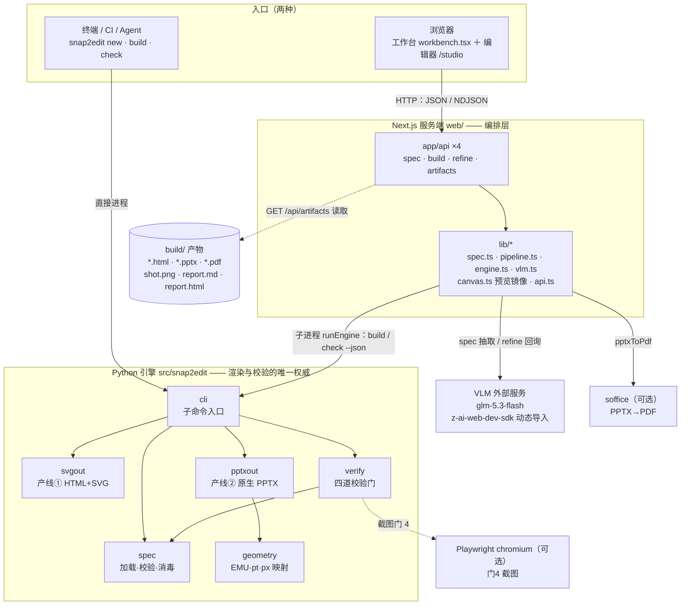
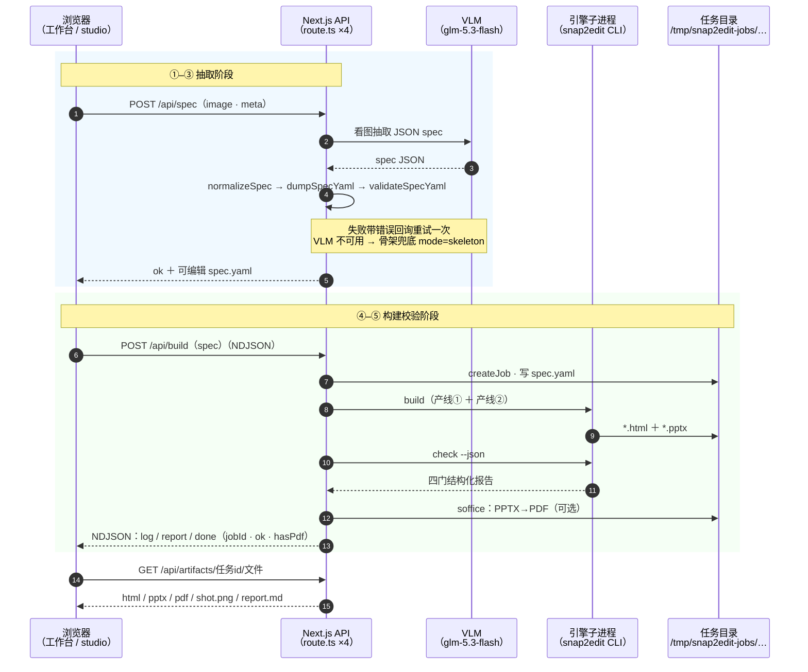
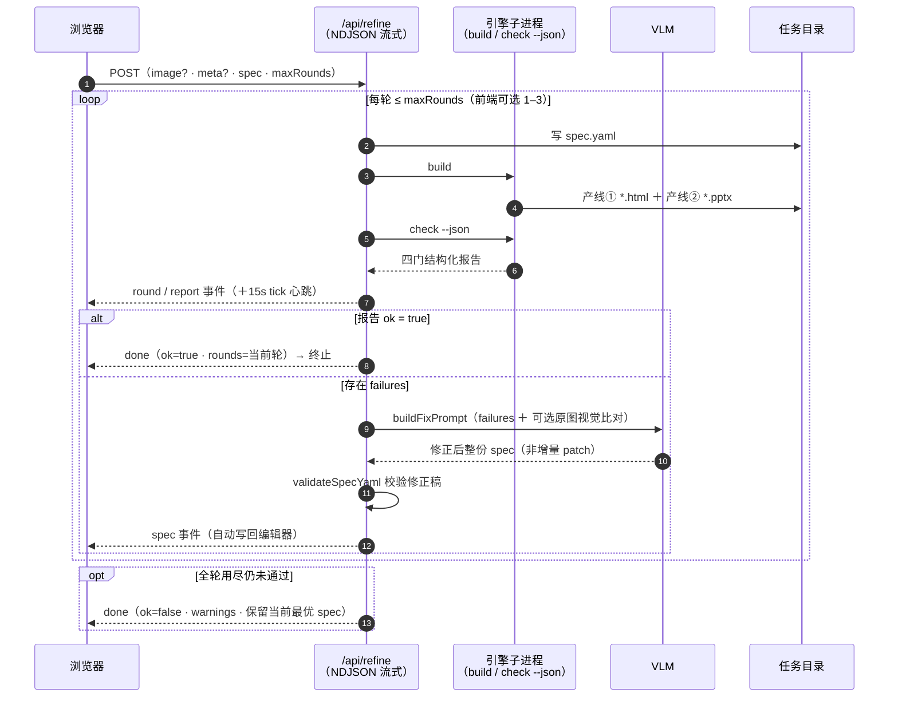

# ARCHITECTURE · Snap2Edit 系统架构文档

| 项 | 内容 |
|---|---|
| 文档版本 | v1.5（首版 v1.0） |
| 系统版本 | v1.0.0（以 `pyproject.toml` 为准） |
| 日期 | 2026-11-03（内容截至 v1.0.0 发布提交） |
| 状态 | 随仓库维护，以仓库为准 |
| 视图模型 | 4+1 视图（逻辑 / 进程 / 部署 / 数据 / 场景）+ C4 容器-组件分层 |
| 关联文档 | 见 §14-C「关联文档索引」 |

## 目录

1. 文档说明 · 2. 系统概述 · 3. 架构总览 · 4. 逻辑视图 · 5. 核心机制设计 ·
6. 进程与运行视图 · 7. 部署视图 · 8. 接口视图 · 9. 数据视图 · 10. 安全设计 ·
11. 质量属性与测试架构 · 12. 架构决策记录（ADR） · 13. 演进路线与风险 · 14. 附录

---

## 1. 文档说明

### 1.1 编写目的

本文档是 Snap2Edit 的**系统架构权威描述**：从软件工程视角完整刻画系统的容器构成、
模块划分、核心机制、运行形态、接口契约、数据模型、安全设计与质量保障，
并沉淀关键架构决策（ADR）。它回答的是「系统为什么这样设计、如何运转、
在哪里演化」，而「具体某行代码怎么写」属于源码与单元测试的职责。

### 1.2 读者与使用方式

| 读者 | 关注章节 |
|---|---|
| 新加入的开发者 | §2–§5（先建立全局图景，再读核心机制） |
| 维护者 / 评审者 | §4、§12（模块边界与决策理由） |
| 集成者 / Agent 流水线搭建者 | §8（接口视图）、§9（数据视图） |
| 运维 / 部署者 | §6、§7、§10 |
| 质量保障 | §11、§13 |

### 1.3 覆盖范围

**包含**：`src/snap2edit`（Python 引擎）、`web`（Next.js 服务与前端）、引擎 CLI、
Web REST API、数据流与数据模型、测试架构、安全设计、演进路线。
**不包含**：`docs/<案例>/` 各复刻案例的内容设计、`docs/workbench/` 历史过程脚本
的内部实现、外部视觉模型服务自身的内部架构。

### 1.4 编写标准与视图模型

- 参照 IEEE 42010（架构描述标准）的思想组织章节，采用 **4+1 视图**
  （逻辑视图=§4、进程视图=§6、部署视图=§7、数据视图=§9、场景=§3.3 数据流）
  与 **C4 容器/组件两档粒度**（§3.2 容器、§4 组件）；
- 图表以 ASCII 字符画为主（与仓库其他文档一致，纯文本、可 diff、可审阅）；
  关键视图另附 Mermaid 版（GitHub 原生渲染，均与 ASCII 图同构、内容一致）：
  §3.2 容器图、§3.3 端到端时序图、§5.4 refine 时序图；
- 术语首用即释（§2.4 术语表集中汇总）；
- 所有数字（行数、超时、覆盖率、阈值）均可在仓库中复核，标注了出处。

---

## 2. 系统概述

### 2.1 系统定位

> 把一张静态图表「复活」为两份完全可编辑的交付物：HTML+SVG 与原生 PPTX。

Snap2Edit 是**规格书驱动的截图复刻引擎**：输入一份 YAML 布局规格（spec），
同步产出「全真实文本、带 id 独立单元、零位图」的 HTML+SVG，与「100% 文本框+形状
（Picture=0）」的原生 PPTX，并自动执行全部质量校验。在 v0.3.0 形态下，系统有
两个入口——终端 CLI（人 / CI / Agent 直接调用）与 Web 在线工作台
（上传图片 → 视觉模型抽取 spec → 构建校验 → 自动回询迭代 → 在线预览下载）。

### 2.2 问题域与架构对策

产品要解决的四个痛点（PRD §1.2）与架构对策一一对应：

| 编号 | 痛点 | 架构对策 | 落点 |
|---|---|---|---|
| P1 | 双产物靠人肉同步，改一处漏一处 | 同一元素树渲染两遍，spec 是唯一事实源 | §5.2 |
| P2 | 校验靠肉眼，验收标准不稳定 | 四道校验门 + 结构化报告，全绿才交付 | §5.3 |
| P3 | 经验散落在一次性脚本与人脑里 | 经验固化为引擎默认行为（换算公式 / CJK 双保险 / 关阴影 / 字宽实测） | §5.7、§4.1 |
| P4 | 无法规模化 | CLI 脚手架 + Web 在线管线 + 可编程接口（`--json` / NDJSON） | §6、§8 |

### 2.3 架构驱动力（质量属性优先级）

1. **正确性与同源性**：HTML 与 PPTX 文案 100% 同源（G1），语义错比对性能更不可接受；
2. **可靠验收**：四道门全绿才允许交付，报告可存档、退出码可被 CI 断言（G2）；
3. **可扩展**：新元素类型 = 两条产线各加一个分支 + 校验可选，不改框架；
4. **性能**：200 元素级 spec，build < 5s、check（含截图）< 15s；
5. **易用性**：`new → 编辑 spec → build → check` 四步出首个产物（G4）。

冲突裁决规则：**性能让位于正确性**。例如门 4 坚持用真实浏览器截图而非估算，
宁可慢； NDJSON 心跳宁可多传字节也要保证长连接不被掐断。

### 2.4 术语表

| 术语 | 定义 |
|---|---|
| 规格书（spec） | 描述画布、字体、色板、文案清单与带 id 元素列表的 YAML 文件，双产线唯一事实源 |
| 产线① / 产线② | spec → HTML+SVG；spec → 原生 PPTX，两条渲染管线 |
| 原生形状 | PowerPoint 中可独立选中编辑的矩形/文本框/连接线等对象，与「嵌入图片」相对 |
| 校验门 | 自动化的质量断言组：门1 HTML、门2 PPTX、门3 边界、门4 截图 |
| 结点 N1–N6 | 六步标准流程的里程碑（规格书/HTML/截图收敛/PPTX/版式校验/终检），见 WORKFLOW.md |
| NDJSON | Newline-Delimited JSON：每行一个 JSON 对象的流式协议，本系统长任务的输出格式 |
| 任务目录（job） | Web 服务为一次构建创建的临时工作目录 `/tmp/snap2edit-jobs/<uuid>/` |
| 双产线同源 | 两条产线从同一 spec 渲染出语义一致的产物（坐标/文案/颜色/旋转） |
| rotate | v0.2.1+ 可选字段：倾斜角度（度、顺时针、[0,360)），双产线同语义 |
| 吸附（snap） | studio 编辑器中拖拽元素时边缘/中线自动对齐参考线的机制 |

---

## 3. 架构总览

### 3.1 架构原则

| # | 原则 | 含义 | 典型体现 |
|---|---|---|---|
| 1 | **单一事实源** | spec.yaml 是唯一权威；正式产物只由 Python 引擎输出 | studio 只做编辑与预览，不做第二套渲染逻辑 |
| 2 | **确定性与智能分离** | 唯一需要智能的「看图写规格」留给人/VLM，其余全部确定性自动化 | VLM 只产出 spec，渲染/校验零 AI 参与 |
| 3 | **生成即校验** | 渲染与校验一体两面，不交付未过门的产物 | build/check 同源；refine 自动把 failures 回询 |
| 4 | **编排与执行分离** | Web 只做编排、流式与展示；渲染与校验复用引擎 | `web/lib/engine.ts` 子进程调用，不重写渲染 |
| 5 | **优雅降级** | 可选依赖缺失时功能降级而非整体失败 | Playwright 缺→门4 跳过；soffice 缺→PDF 禁用 |
| 6 | **错误可读** | 报错必须含元素定位与修复建议，全 JSON 不吐 HTML | `SpecError` 带 `elements[i](id)`；NDJSON error 事件 |

### 3.2 容器视图（C2）

```
  入口 A：终端 / CI / Agent                入口 B：浏览器
┌───────────────────────┐        ┌─────────────────────────────────┐
│  snap2edit new/build/ │        │  工作台（workbench.tsx）         │
│  check（CLI，退出码0/2）│        │  可视化编辑器（/studio editor.tsx）│
└──────────┬────────────┘        └──────────────┬──────────────────┘
           │ 直接进程                            │ HTTP：JSON / NDJSON
           ▼                                    ▼
┌──────────────────────────────┐   ┌─────────────────────────────────┐
│   Python 引擎（src/snap2edit）│   │   Next.js 服务端（web/）          │
│   spec      加载/校验/消毒     │   │   route.ts ×4 + lib/*（编排层）   │
│   geometry  EMU/pt/px 映射    │   │   spec.ts 提示词/归一化/预校验     │
│   svgout    产线① HTML+SVG    │   │   engine.ts 子进程/任务目录/soffice│
│   pptxout   产线② 原生 PPTX   │◀──│   pipeline.ts NDJSON/心跳/四门    │
│   verify    四道校验门        │子 │   vlm.ts 视觉模型客户端           │
│   cli       子命令入口        │进 │   canvas.ts SVG 预览镜像（TS）    │
└──────────┬───────────────────┘程 └──────┬──────────────┬───────────┘
           │                              │              │
           ▼                              ▼              ▼
┌──────────────────┐        ┌────────────────┐  ┌────────────────────┐
│ 文件系统产物       │        │ VLM（外部服务）  │  │ 系统工具（可选）     │
│ <dir>/build/*.html│        │ glm-5.3-flash  │  │ soffice  PPTX→PDF  │
│ *.pptx shot.png   │        │ z-ai-web-dev-  │  │ Playwright 截图门4  │
│ report.md/.html   │        │ sdk 动态导入    │  │ （chromium）        │
└──────────────────┘        └────────────────┘  └────────────────────┘
```

**Mermaid 版容器图**（GitHub 原生渲染；与上图同构，供交互式查看与复制改画）：



两个入口共享**同一个引擎核心**：CLI 直接进程内调用；Web 通过子进程
（优先 `snap2edit` CLI，其次 `python3 -m snap2edit.cli`）调用。
引擎对 Web 暴露两个稳定面：`build`（文件产物）与 `check --json`（结构化四门报告）。

### 3.3 端到端数据流与六步流程映射

**在线管线数据流**（spec 的生命周期，8 步）：

```
① 原图（浏览器端限尺 ≤2000px / canvas 取色）
② POST /api/spec：VLM 看图产出 JSON spec
     normalizeSpec（拆行/旋转归一/色板）→ dumpSpecYaml → validateSpecYaml
     （失败带错误回询重试一次；VLM 不可用回退骨架模板 mode:skeleton）
③ spec.yaml（唯一事实源，进入 studio 可继续可视化编辑）
④ POST /api/build：写任务目录 → 引擎 build（产线①+②）→ check --json（四道门）
     → PPTX → PDF（soffice，可选）
⑤ GET /api/artifacts/<jobId>/<file>：iframe 预览 / 下载
⑥ 未通过 → POST /api/refine：failures 回询 VLM 修正 spec → 重建复检
     循环 maxRounds 轮（全程 NDJSON：log/tick/round/report/spec/done）
⑦ 全绿 done：HTML + PPTX(+PDF) + shot.png + report.md
⑧ 正式沉淀：仓库 docs/<案例>/ 归档（任务目录为临时，重启即清空）
```

**Mermaid 时序图**（GitHub 原生渲染；与上图 8 步流程同构，展示参与者间的消息次序）：



**与六步标准流程（WORKFLOW.md）的映射**——工具化的本质是把人工流程逐结点收口：

| 结点 | 工具能力 |
|---|---|
| N1 原图分析→规格书 | 人工 / VLM 编写 spec（/api/spec、studio），F1 校验器把关 |
| N2 HTML+SVG 生成 | 产线①（门 1 收口） |
| N3 截图对比收敛 | 门 4 截图 + 可选原图块差异；refine 自动回询 |
| N4 PPTX 原生生成 | 产线②（门 2 收口） |
| N5 版式校验 | 门 3 字宽实测（soffice 渲染留作 CI 扩展） |
| N6 终检 | 门 1/2 文案与占位符断言 + report.md 存档 |

### 3.4 核心思想：确定性与智能分离

把复刻流程按「是否需要智能」切成两半，是整个架构的第一性原理。
「看图写规格」——理解布局、估角度、取颜色、抄文案——是唯一不可确定性自动化的
环节，交给人与视觉模型，且其产出必须通过确定性校验器才能进入产线；
其余环节（坐标换算、双语言渲染、CJK 字体、字宽防溢出、截图比对）全部
确定性工具化，因此 **v0 即可 100% 可靠**：智能部分的质量由「校验门 + 自动回询
迭代」兜底收敛，确定性部分由单元测试与四道门保障。这同时决定了依赖边界：
AI 是可替换的外部组件（vlm.ts 单点接入），不是引擎的一部分。

---

## 4. 逻辑视图（模块划分）

### 4.1 Python 引擎（`src/snap2edit`，10 文件 2041 行）

| 模块 | 行数 | 职责 | 关键 API |
|---|---|---|---|
| `spec.py` | 239 | 规格书加载、结构校验（含组件库四类）、项目名消毒、颜色规范化 | `load` / `validate` / `safe_project` / `norm_color` / `texts_of` / `text_tag_count` / `SpecError` |
| `geometry.py` | 37 | 坐标系映射（px ⇄ EMU ⇄ pt）与幻灯片 EMU 解析 | `Mapper` / `resolve_slide_emu` |
| `components.py` | 171 | 组件库唯一事实源：颜色演算（shade/contrast）、cube/matrix 几何、10 种参数化图标 | `shade` / `contrast_text` / `cube_faces` / `matrix_cells` / `icon_parts` / `ICONS` |
| `svgout.py` | 268 | 产线①：spec → HTML+SVG（全真实 `<text>`；组件拆为面片/格子/部件独立单元） | `render_html` / `render_element` |
| `pptxout.py` | 339 | 产线②：spec → 原生 PPTX（文本框/形状/连接线/Freeform 多边形） | `render_pptx` |
| `verify.py` | 341 | 四道校验门 + 结构化报告 + 截图/量宽/块差异（含 F7 热力图数据源 `block_diff_grid`） | `collect_checks` / `run_checks` / `check_html` / `check_pptx` / `check_bounds` / `screenshot` / `block_diff` / `block_diff_grid` / `text_width_px` |
| `report.py` | 367 | F7 可视化报告：状态灯映射 / 热力图绘制 / 溢出坐标回映射 / 单文件 HTML 组装 | `write_html` / `render_html` / `node_status` / `heatmap_png` / `overflow_marks` / `elem_boxes` / `canvas_svg` |
| `cli.py` | 255 | 子命令入口（`new` / `build` / `check` / `loop`），函数内延迟导入 | `main` / `cmd_new` / `cmd_build` / `cmd_check` / `cmd_loop` |
| `__main__.py` | 8 | `python -m snap2edit` 入口 | 转发 `cli.main` |
| `__init__.py` | 5 | 包版本号 | `__version__` |

### 4.2 Web 服务端（`web/lib`，6 模块 1668 行）

| 模块 | 行数 | 职责 | 关键 API |
|---|---|---|---|
| `spec.ts` | 515 | VLM 提示词构建（含组件库指引）、JSON→YAML 序列化、normalizeSpec、TS 侧校验器、骨架兜底 | `buildSystemPrompt` / `buildUserPrompt` / `buildFixPrompt` / `normalizeSpec` / `dumpSpecYaml` / `validateSpecYaml` / `buildSkeletonYaml` / `parseSpecJson` |
| `engine.ts` | 217 | 引擎子进程解析与调用、任务目录（UUID）、产物白名单解析、PPTX→PDF | `resolveEngine` / `runEngine` / `createJob` / `resolveArtifact` / `pptxToPdf`（90s 超时） |
| `pipeline.ts` | 110 | build+check 编排、NDJSON 流式包装、心跳、spec 预校验 | `buildAndCheck` / `streamEvents` / `startHeartbeat`（15s）/ `prevalidate` / `finalizePdf` |
| `api.ts` | 118 | 浏览器侧 fetch 辅助与事件/报告类型（三层防线之客户端层） | `readApiJson` / `streamApi` |
| `canvas.ts` | 653 | 客户端 SVG 画布渲染（svgout.py 的 TS 镜像，含组件库几何/图标同源移植）、吸附、bbox、texts 同步 | `renderSpecSvg` / `computeSnap` / `elBBox` / `regenTexts` / `syncTextOnEdit` / `ICONS` / `cubeFaces` / `matrixCells` |
| `vlm.ts` | 55 | 视觉模型客户端（z-ai-web-dev-sdk 按需动态导入）、超时包装 | `getVLM` / `withTimeout`（150s）/ `vlmUnavailableMsg` |

### 4.3 Web 应用层（`web/app`）

| 组件/路由 | 行数 | 职责 |
|---|---|---|
| `workbench.tsx` | 622 | 全链路工作台：上传 → spec 编辑 → 构建预览 → 自动迭代 |
| `studio/editor.tsx` | 1650 | 可视化编辑器：元素列表 / SVG 画布（点选·拖拽·框选·手柄变换·读出气泡）/ 属性面板（含组件库字段）/ YAML 双向同步 / 构建出口 |
| `api/spec/route.ts` | 171 | POST：VLM 抽取 → normalize → 校验 → 兜底 |
| `api/build/route.ts` | 58 | POST：双渲染 + 四道门（NDJSON） |
| `api/refine/route.ts` | 197 | POST：自动回询迭代闭环（NDJSON） |
| `api/artifacts/[id]/[file]/route.ts` | 44 | GET：产物服务（UUID + kind 双白名单，`?dl=1` 下载） |
| `page.tsx` / `layout.tsx` / `globals.css` | — | 首页（工作台+流水线+案例索引）、根布局（zh-CN）、全局样式（无 UI 框架依赖） |

### 4.4 模块间依赖方向

```
cli（入口；cmd_* 函数内延迟导入，保证 --version 等轻量路径秒回）
 ├──▶ spec ─────▶ components（图标名清单；spec 侧其余仅依赖 PyYAML+re）
 ├──▶ svgout ───▶ components（几何/配色/图标唯一事实源）
 ├──▶ pptxout ──▶ geometry（EMU/pt/px 映射） + components
 └──▶ verify ───▶ spec（texts_of / text_tag_count） + components（门3 组件边界）
            └─(延迟导入)─▶ report ───▶ verify（block_diff_grid/check_bounds） + components
```

依赖为**单向无环**：components 与 geometry 是底座，两条产线互不依赖，
verify 横切两条产线的产物，cli 是唯一入口。svgout 不依赖 geometry 是有意为之：
产线① 的 viewBox 与画布 1:1，根本不需要换算；这也意味着产线① 天然免疫换算类 bug。
组件库（F6）落位为独立底座 `components.py`：几何/配色/图标数据只写一遍，
两条产线各自把同一份定义翻译为原生单元（SVG polygon/polyline ⇄ PPTX Freeform）。

### 4.5 Web 与引擎的边界约束

**渲染唯一权威是 Python 引擎**；Web 侧存在三处「镜像」，是必须人工保持同语义的约束点：

| 镜像对 | 同语义内容 | 漂移防线 |
|---|---|---|
| `web/lib/canvas.ts` ⇄ `src/snap2edit/svgout.py` | 坐标/圆角/文本基线/箭头三角/rotate 及组件库（cube 面片/matrix 格子/flow-box 色带/icon 部件）的 SVG 表达 | 两侧行为均有单测锚定（canvas.spec.test.ts / components.spec.test.ts 等） |
| `web/lib/spec.ts` 校验规则 ⇄ `src/snap2edit/spec.py` | 元素类型白名单、几何字段、rotate 分级规则、组件库约束（rows/cols/icon 名/flow-box 内容） | 双端校验：TS 预检（编辑器即时反馈）+ Python 终检（build 前兜底） |
| `web/lib/spec.ts` ELEMENT_TYPES ⇄ 引擎元素表 | 11 种元素类型及其几何字段 | 类型常量集中定义一处 |

这是架构上**已知且有意的重复**：TS 侧校验让编辑器获得毫秒级反馈，Python 终检
保证任何绕过前端的调用（curl / Agent）同样被拦截。漂移风险由「两侧规则都有
单元测试锁定 + 修改时必须同步」的协作约定控制（见 §13.3）。

---

## 5. 核心机制设计

### 5.1 规格书数据模型

spec.yaml 的顶层字段与校验规则是全系统的契约，任何入口（人写 / VLM 产出 /
studio 编辑）产出的 spec 都必须满足同一套规则：

| 字段 | 必填 | 说明 |
|---|---|---|
| `project` | ✅ | 产物文件名；经 `safe_project` 消毒（空格/斜杠/特殊字符→`_`，保留中文，≤60 字符） |
| `canvas` | ✅ | `width/height`（默认 1280×720），viewBox 与画布 1:1 |
| `slide` |  | `preset: "16:9"` 或显式 `emu_w/emu_h` |
| `font` |  | `name / fallback / pptx_name`（HTML 侧 Noto Sans SC，PPTX 侧 Microsoft YaHei） |
| `palette` |  | 语义色（primary/accent/card/muted…），`norm_color` 统一 `#RGB/#RRGGBB/#RRGGBBAA`，`none/transparent`→透明 |
| `texts` | 建议 | 终检文案清单（缺省由 `texts_of` 自动收集），门 1/门 2 逐条核对 |
| `elements` | ✅ | 元素列表，见 §9.2 元素表 |

**结构校验**（`spec.validate`，加载即执行）：元素类型合法、几何字段齐全、id 唯一、
携带文字必有 size、占位符黑名单（`XXX/TODO/待补充/【/undefined/NaN`）。
所有错误信息携带元素定位（`elements[i](id)`）与修复建议——这是「错误可读」
原则的落地，也是 refine 能把 failures 直接回询给 VLM 的前提（错误文本即修正指令）。

**rotate 语义**（v0.2.1+，全链路同语义）：数值（度）、顺时针、范围 [0,360)、
可带一位小数；盒子绕自身中心、自由文本绕锚点；线段/箭头的倾斜由端点坐标承载，
rotate 键在 normalize 阶段剔除（并在校验中降级为 warning）。详见 `docs/ROTATE.md`。

### 5.2 双产线同源渲染

#### 5.2.1 产线①（svgout.py → HTML+SVG）

全部文字为真实 `<text>`；每个元素是带 id 的独立最小单元（html 元素 + svg 节点）；
**禁止 `<image>` / `data:image`**；箭头渲染为「线段 + 三角」两个独立单元；
HTML 壳提供 `#stage` / `#canvas` 锚点供截图门与二次开发定位。渲染过程零坐标
换算（viewBox 1:1），文本统一「y = 文本块顶部」语义。

#### 5.2.2 产线②（pptxout.py → 原生 PPTX）

100% 文本框 + 形状（门 2 断言 `Picture = 0`）；形状 `name = 元素 id`，可被脚本
单独寻址。内置规则全部是历史经验的固化：px→EMU、px→pt 换算（geometry.Mapper）；
文本框 `margin=0`、`word_wrap=False`；`a:ea` / `a:cs` 东亚字体双保险（CJK 在
PowerPoint 中需要三处字体位才不回退宋体）；关闭继承阴影（避免渲染差异）；箭头 =
连接线 + tailEnd 三角；带 `rotate` 时 `shape.rotation` + 文本框重定位
（自由文本绕锚点重新计算盒位置）。

#### 5.2.3 同源语义对照表

| 概念 | 产线①（SVG） | 产线②（PPTX） |
|---|---|---|
| 盒子 rotate | `transform=rotate(deg cx cy)` 绕中心 | `shape.rotation`（PowerPoint 原生绕中心） |
| 自由文本 rotate | 绕锚点 rotate | 文本框重定位 + rotation（锚点语义一致） |
| 文本基线 | y = 文本块顶部 | MSO_ANCHOR.TOP + margin=0 |
| 箭头 | 线段 + 三角两单元 | 连接线 + tailEnd 三角 |
| 透明填充 | `fill=none` | 无填充形状 |
| 中文 | `font.name` | latin + `a:ea` + `a:cs` 三字体位 |

### 5.3 四道校验门

校验是系统的质量中枢：CLI `check` 输出人读报告（文本版 report.md ＋ F7 可视化
report.html），`check --json` 输出同一份结构化报告（供 Web 与 CI），三者同源
（`collect_checks` 为实现，`run_checks` 为薄包装）。可视化报告属报告层而非校验门：
生成失败不阻断校验结论，仅记日志并将 `report_html` 置空。

| 门 | 对象 | 检查项 | 失败语义 |
|---|---|---|---|
| 门 1 | HTML | `<text>` 数量覆盖、无 `<image>`/`data:image`、texts 清单逐条在场、占位符黑名单 | 阻断 |
| 门 2 | PPTX | 幻灯片尺寸 EMU、`Picture=0`、文案清单逐条在场、占位符黑名单 | 阻断 |
| 门 3 | spec+渲染 | PIL 实测每段文字宽度 vs 可用宽度（w 或画布右缘，预留 5% 余量），溢出即失败 | 阻断 |
| 门 4 | 截图 | Playwright 元素级截图、非白像素 >2%（防空白页）；可选 `--original` 启用 16px 块差异（总平均差异 <10/255） | 缺依赖跳过 |

结构化报告 schema（`collect_checks` 输出，Web/CI 共同消费）：

```json
{
  "ok": false,
  "project": "my-chart",
  "gates": [
    { "gate": 1, "title": "HTML 校验",
      "items": [ { "label": "文案覆盖", "passed": false, "detail": "缺少: 卡片B" } ] }
  ],
  "failures": ["门1 · 文案覆盖：缺少: 卡片B"],
  "artifacts": { "html": "…", "pptx": "…", "shot": "…" },
  "report_md": "…",
  "report_html": "…" | null
}
```

`failures[]` 是面向「回询」设计的：每条都是含修复指引的自然语言
（「改哪里」而不是「不对」），可直接拼进 VLM 修正提示词（§5.4）。

### 5.4 自动回询迭代（refine）

```
POST /api/refine { image?, meta?, spec, maxRounds }        （NDJSON 流式）
└── 循环（≤ maxRounds，前端可选 1–3）：
      ① buildAndCheck：写任务目录 → 引擎 build → check --json
      ② report.ok === true → done（rounds=当前轮），终止
      ③ 否则：failures（+ 可选原图视觉比对）拼入 buildFixPrompt 回询 VLM
         → VLM 返回修正后整份 spec → 校验 → 下一轮重建复检
      ④ 超限：保留当前最优 spec，附 warnings 收尾
```

**Mermaid 时序图**（GitHub 原生渲染；与上图循环结构同构，alt/opt 分支对应 ②③④）：



设计要点：修正策略是**整图重抽取 + 错误清单反馈**而非增量 patch——VLM 对
「全局重新画一遍并注意这些错误」的可靠性显著高于「在第 137 行改一个坐标」；
`image` 可选：studio 纯编辑入口不带原图时按报告纯文本修正，工作台带原图时
叠加视觉比对。该机制的可靠性来源于 §5.3 的 failures 文本质量与 §5.1 的
可读错误约定。

### 5.5 NDJSON 流式协议

**为什么**：VLM 抽取 30–150s、多轮迭代更久；预览网关对长静默连接会掐断并返回
HTML 错误页。NDJSON 让字节持续流动，配合 15s `tick` 心跳，网关无静默期可掐。

事件类型（`BuildEvent` 联合类型，`Content-Type: application/x-ndjson`）：

| 事件 | 载荷 | 用途 |
|---|---|---|
| `log` | 文本 | 过程日志 |
| `tick` | — | 心跳保活（15s 间隔，`startHeartbeat`） |
| `round` | 轮次/阶段 | refine 迭代进度 |
| `report` | 四门结构化报告 | 每轮构建的校验结果 |
| `spec` | YAML 文本 | 修正后的 spec（前端写回编辑器） |
| `done` | jobId/ok/hasPdf/rounds/spec/warnings/elapsedMs | 终态 |
| `error` | 中文可读错误 | 任何异常（也保证错误不退化成 HTML） |

### 5.6 健壮性三层防线

JSON.parse 事故（预览网关把 HTML 错误页喂给 `res.json()`）的根治，固化为三层：

| 层 | 措施 | 位置 |
|---|---|---|
| 服务端 | handler 全量 try/catch；所有分支（400/404/413/500）只回 `NextResponse.json()`；引擎缺失/崩溃/超时给中文可读错误 | `app/api/*/route.ts` |
| 协议 | 长任务一律 NDJSON 流式 + tick 心跳 | `lib/pipeline.ts` |
| 客户端 | `readApiJson` 先查 Content-Type 再 parse；`streamApi` 逐行解析、混入的非 JSON 行忽略 | `lib/api.ts` |

错误注入实测（修复后，详见 WEB_PIPELINE.md §2）：非法 body→400 JSON；
`elements:[]` 的 spec→400 结构预校验失败；路径穿越→404；假 UUID→404 JSON。

### 5.7 几何映射与字宽实测

三条核心公式（内置 geometry.py / verify.py，源头是 WORKFLOW.md 的实战经验）：

```text
EMU/px = 幻灯片宽 EMU ÷ 画布 px 宽        # 16:9(12192000×6858000) + 1280×720 → 9525
pt/px  = (幻灯片高 EMU ÷ 914400 × 72) ÷ 画布 px 高   # 同上 → 0.75
字宽实测 = ImageFont(size=100).getlength(t) / 100 × size
```

- `Mapper` 封装换算，产线②所有坐标/尺寸/线宽都经它出 EMU/pt；
- 门 3 用 PIL 以 100px 基准量宽再线性缩放（避免小字号渲染误差），
  字体缺失时按字符宽度估算量宽（可移植性优先，PRD §7）；
- 双产线统一「y = 文本块顶部」语义，消除 SVG 与 PPTX 文本基线机制的 ±2px 错位。

---

## 6. 进程与运行视图

### 6.1 两种运行形态

| 形态 | 进程模型 | 适用 |
|---|---|---|
| CLI | 单进程同步执行；`build` 秒级、`check` 含截图数十秒 | 人手操作、CI、Agent 批量 |
| Web | Next.js 常驻服务；每次 build/refine 经 `runEngine` 派生引擎子进程 | 在线工作台、studio |

### 6.2 CLI 运行时

```
snap2edit new <dir>     # 生成 spec.yaml 模板（已存在则退出码 1）
snap2edit build <dir>   # spec.load → safe_project → svgout.render_html
                        #           → pptxout.render_pptx → <dir>/build/
snap2edit check <dir> [--original IMG] [--no-shot] [--json]
                        # spec.load → collect_checks
                        # --json：stdout 一行 JSON；退出码 0/2（CI 可断言）
```

`cmd_*` 内延迟导入渲染/校验模块，使 `--version` 等轻量路径不加载 python-pptx。
退出码语义：0=全绿；2=任一门失败（PRD F10 预留 CI 工作流）。

### 6.3 Web 运行时

- **引擎解析**（`resolveEngine`）：优先 PATH 上的 `snap2edit` CLI，
  其次 `python3 -m snap2edit.cli`；两者皆缺返回 null → API 给中文可读错误；
- **任务目录**（`createJob`）：`/tmp/snap2edit-jobs/<uuid>/`，内含 spec.yaml 与
  build/ 产物；重启即清空，属预期设计（正式沉淀走仓库 docs/ 归档）；
- **产物服务**（`resolveArtifact`）：kind 白名单 `html/pptx/pdf/shot.png/report.md/report.html`（F7 后 build/ 内有两个 .html：`html` kind 排除 report.html、`report.html` kind 只命中报告本体，错位隔离），
  UUID 格式校验，`?dl=1` 切换下载形态；
- **PPTX→PDF**（`pptxToPdf`）：soffice 无头转换，90s 超时，失败返回 null
  （前端 PDF 页签禁用，不阻断其余功能）。

### 6.4 超时与心跳参数

| 参数 | 值 | 位置 |
|---|---|---|
| VLM 调用超时 | 150s（`VLM_TIMEOUT_MS`） | `vlm.ts` |
| tick 心跳间隔 | 15s | `pipeline.ts` |
| PPTX→PDF 超时 | 90s | `engine.ts` |
| refine 最大轮次 | 前端可选 1–3（`maxRounds`） | `refine/route.ts` |
| 图片 dataURL 上限 | 11,000,000 字符（`MAX_IMAGE_CHARS`） | `spec.ts` |

### 6.5 失败模式与优雅降级矩阵

| 缺失依赖 | 行为 | 用户感知 |
|---|---|---|
| Playwright（门 4） | 该门标记 skip，其余三门照跑 | 报告注明，不阻断 |
| soffice（LibreOffice） | PDF 转换返回 null | PDF 页签禁用，PPTX 下载不受影响 |
| VLM / sdk | /api/spec 回退骨架模板 `mode:skeleton` | 可手写 spec 继续全流程 |
| 中文字体 | 字宽按估算量宽 | 门 3 精度略降，不失败 |
| 引擎本体未安装 | API 返回中文可读错误 JSON | 提示 `pip install -e .` |

---

## 7. 部署视图

### 7.1 部署拓扑（单机）

```
┌────────────────── 单机（本地 / 沙箱） ──────────────────┐
│  终端：snap2edit CLI（pip install -e . 安装）            │
│  浏览器 ──▶ http://localhost:3000（沙箱实测用 3210）      │
│              Next.js server（npm run build && start）    │
│                ├─ 引擎子进程（snap2edit / python3 -m）    │
│                ├─ z-ai-web-dev-sdk ──▶ VLM 外部服务       │
│                ├─ soffice（可选）──▶ PDF                  │
│                └─ playwright chromium（可选）──▶ 门 4     │
│  文件系统：/tmp/snap2edit-jobs/<uuid>/（临时任务目录）     │
└──────────────────────────────────────────────────────────┘
外部：GitHub 仓库（源码与案例归档）、PyPI（引擎分发，tag 触发发布）、
GitHub Pages（MkDocs 文档站，main 推送自动部署）、VLM 服务（外部 API）
```

### 7.2 环境要求与安装

| 项 | 要求 |
|---|---|
| Python | ≥ 3.9；`pip install snap2edit`（PyPI）或 `pip install -e .`（源码）；门 4 截图：`pip install -e ".[verify]"` + `playwright install chromium` |
| Node | 运行 Web ≥ 18（Next 16）；**跑 Web 单测需 ≥ 24**（node --test 原生执行 TS） |
| 系统工具 | LibreOffice（PDF 预览，可选）；poppler-utils（高级校验，可选） |
| 字体 | Noto Sans SC（HTML/量宽）；Microsoft YaHei 由 PPTX 消费端承载 |

### 7.3 目录布局

```
snap2edit/
├── docs/                     # 文档与案例库（索引见 docs/README.md）
│   ├── PRD.md WORKFLOW.md WEB_PIPELINE.md ROTATE.md ARCHITECTURE.md …
│   └── <案例名>/             # 原图 + *.html + *.pptx + 预览 + README
├── examples/demo/            # 引擎示例 spec + 构建产物（含 report.md / report.html）
├── src/snap2edit/            # Python 引擎（spec/geometry/svgout/pptxout/verify/cli）
├── tests/                    # pytest：test_units(27) + test_smoke(6)
└── web/                      # Next.js 16（app/ + lib/ + tests/ 44 项）
运行时：
/tmp/snap2edit-jobs/<uuid>/   # spec.yaml + build/{*.html,*.pptx,*.pdf,shot.png,report.md,report.html}
```

---

## 8. 接口视图

### 8.1 引擎 CLI 接口

| 命令 | 输入 | 输出 | 退出码 |
|---|---|---|---|
| `snap2edit new <dir>` | 目录 | `spec.yaml` 模板 | 0 / 1（已存在） |
| `snap2edit build <dir>` | `<dir>/spec.yaml` | `<dir>/build/<project>.html` + `.pptx` | 0 |
| `snap2edit check <dir> [--original IMG] [--no-shot]` | 项目目录 | `build/report.md` ＋ `report.html` | 0 / 2 |
| `snap2edit check <dir> --json` | 同上 | stdout 单行结构化 JSON（§8.4） | 0 / 2 |
| `python -m snap2edit --version` | — | `snap2edit 0.3.0` | 0 |

### 8.2 Web REST API

| 路由 | 方法 | 输入 | 输出 | 说明 |
|---|---|---|---|---|
| `/api/spec` | POST | `{ image: dataURL, meta }` | JSON `SpecResult` | VLM 抽取；失败带错误回询重试一次；VLM 不可用回退骨架 |
| `/api/build` | POST | `{ spec: YAML }` | NDJSON 事件流 | 双渲染 + 四道门 + PPTX→PDF |
| `/api/refine` | POST | `{ image?, meta?, spec, maxRounds? }` | NDJSON 事件流 | 自动回询迭代闭环（image 可选） |
| `/api/artifacts/<id>/<file>` | GET | UUID + 白名单 kind | 文件（MIME 正确） | `?dl=1` 强制下载 |

**约定：所有路由的所有分支（含 400/404/413/500）只返回 JSON，绝不返回 HTML/纯文本错误页。**

### 8.3 NDJSON 事件协议

见 §5.5 事件表。前端 `streamApi` 逐行解析；任何一行不是合法 JSON（如代理注入
提示）直接忽略——协议对脏行宽容，保证用户永远拿到的是结构化事件而非解析异常。

### 8.4 结构化校验报告 schema

见 §5.3。CLI `--json` 与 Web `report` 事件消费的是同一份数据，
这是「CLI 与 Web 同源」在接口层的体现。

### 8.5 错误语义约定

| 场景 | 表现 |
|---|---|
| spec 非法 | 400 + `{"ok":false,"error":"spec 未通过结构预校验：…"}`（含元素定位） |
| 引擎缺失/崩溃/超时 | 500 + 中文可读错误（不含堆栈） |
| 产物不存在 / 穿越尝试 | 404 JSON |
| 引擎校验失败（非系统错误） | 不算 API 错误：`done{ok:false}` + report 事件，由 refine 接手 |

---

## 9. 数据视图

### 9.1 spec.yaml 字段速查

见 §5.1 顶层字段表。数据格式决策（YAML 而非 JSON）的理由：手写友好、支持注释、
适合人机共编（人改文案、AI 起草布局）。

### 9.2 元素类型与几何字段

| type | 几何字段 | 专属属性 | 说明 |
|---|---|---|---|
| `rect` | x y w h | fill / stroke / stroke_width / rotate | 矩形 |
| `rrect` | x y w h | rx / rotate | 圆角矩形 |
| `pill` | x y w h | rotate | 胶囊（rx=h/2） |
| `circle` | x y w h | fill / stroke / stroke_width / rotate | 椭圆（内切于包围盒） |
| `text` | x y（w 可选） | size / bold / color / align / lines / line_height / rotate | 自由文本 |
| `line` | x1 y1 x2 y2 | stroke / stroke_width | 直线（倾斜由端点承载，rotate 键被剔除） |
| `arrow` | x1 y1 x2 y2 | stroke / stroke_width / head | 箭头（线段+三角两个单元） |

带 `text`+`size` 的盒子自动渲染居中文字（PPTX 侧为独立文本框）。

### 9.3 任务目录与产物清单

一次 Web 构建（`/tmp/snap2edit-jobs/<uuid>/`）：

| 文件 | 来源 | 消费方 |
|---|---|---|
| `spec.yaml` | 请求体 / refine 写回 | 引擎 build/check、artifacts 下载 |
| `build/<project>.html` | 产线① | iframe 预览、门 4 截图 |
| `build/<project>.pptx` | 产线② | 下载、soffice→PDF、门 2 |
| `build/<project>.pdf` | soffice 转换（可选） | PDF 预览 |
| `build/shot.png` | 门 4 截图 | 预览、非空白断言 |
| `build/report.md` | collect_checks | 预览、存档 |
| `build/report.html` | collect_checks（F7） | 可视化报告：状态灯/并排图/热力图/溢出标注 |

### 9.4 数据一致性与生命周期

- **texts 双通道**：spec 显式清单（推荐）或 `texts_of` 自动收集；studio 编辑元素时
  `syncTextOnEdit`/`regenTexts` 保持清单与元素一致，保证门 1 可过；
- **生命周期**：任务目录临时（重启即清空）→ 用户确认成果后按协作规则归档到
  `docs/<案例名>/`（原图 + 双产物 + 预览 + README）——「以仓库为准」；
- **不可变产物**：产物一经写入任务目录不再修改，refine 每轮重建新内容
  （同目录覆盖），前端以事件序号而非文件时间戳对齐状态。

---

## 10. 安全设计

| 面 | 措施 | 证据（实测/单测） |
|---|---|---|
| 路径穿越 | artifacts 路由 UUID 格式校验 + kind 白名单双防线；jobId 先归一化再拼接 | `GET /api/artifacts/../etc/html` → 404 |
| 文件名注入 | `safe_project` 消毒产物文件名（特殊字符→`_`，保留中文，≤60 字符） | test_smoke::test_safe_project |
| 请求体滥用 | dataURL 长度上限 `MAX_IMAGE_CHARS`（约 11MB）→ 413 | spec 路由 |
| 错误信息泄露 | 全分支 JSON、中文可读错误、不含堆栈与内部路径 | 错误注入实测（WEB_PIPELINE §2） |
| 数据持久化 | 无用户数据落库；任务目录在 /tmp 且重启即清空 | 架构设计（§6.3） |
| 凭据 | 推送凭据仅内嵌单次 push URL，不写 remote、不落盘，输出一律脱敏 | COLLABORATION 规则 |
| 隐私（v2 预留） | AI 功能默认本地文案先行，图片外发显式 opt-in | PRD §7 |

---

## 11. 质量属性与测试架构

### 11.1 质量属性目标（PRD §7）与现状

| 维度 | 要求 | 现状 |
|---|---|---|
| 兼容性 | PPTX 兼容 PowerPoint 2016+/WPS/Keynote；HTML 兼容 Chrome/Edge/Safari | 达成（原生形状 + 开源字体策略） |
| 性能 | 200 元素：build <5s、check <15s | 达成（demo 3.8s，实测评见 WEB_PIPELINE §4） |
| 可移植 | 纯 Python + 可选系统工具；字体缺失按估算量宽 | 达成（§6.5 降级矩阵） |
| 可扩展 | 新元素 = 两产线各一分支 + 可选校验，不改框架 | 达成（circle 即按此路径新增） |
| 错误体验 | 错误含定位与修复建议 | 达成（SpecError / failures 回询） |
| 安全 | 不上传用户文件；图片外发 opt-in | 达成（§10） |

### 11.2 测试策略（三层）

```
        第三层  E2E / 真实探针（沙箱侧 Playwright 脚本，不随仓库分发）
                studio 交互链路 · Web 全链路 · rotate 端到端 · 真实 VLM 探针
       ─────────────────────────────────────────────────────────────
        第二层  引擎冒烟（tests/test_smoke.py，6 项）
                new→build→check 全链路 · rotate 端到端 · collect_checks --json
       ─────────────────────────────────────────────────────────────
        第一层  纯逻辑单测
                引擎 tests/test_units.py（27 项：spec/geometry/cli/渲染分支/verify）
                Web  web/tests/（44 项：lib/spec / lib/canvas / lib/api / rotate 规则）
```

选型说明：Web 单测用 **Node ≥24 原生执行 TS**（`node --test tests/*.test.ts`），
零编译步骤、零测试框架依赖；引擎用 pytest + coverage（`.coveragerc` 开启
greenlet 并发追踪，保证门 4 异步截图路径计入覆盖）。studio 交互链路（拖拽/
框选/手柄/读出气泡）不适合纯逻辑单测，由沙箱侧 Playwright E2E 覆盖
（记录见 ROTATE.md §4 测试矩阵）。

### 11.3 覆盖率现状（截至 `9bae757`）

| 侧 | 命令 | 结果 |
|---|---|---|
| 引擎 | `python -m coverage run -m pytest tests/ -q && python -m coverage report` | 33 项全绿，行覆盖 ≈99% |
| Web | `cd web && npm run test:cov`（V8 覆盖率） | 44 项全绿，行覆盖 100% |

### 11.4 可观测性

- **人读**：`build/report.md`（四门逐项 ✓/✗ + 明细）＋ `build/report.html`（F7 可视化：状态灯/并排图/热力图/溢出标注）；
- **机读**：`check --json` 结构化报告（Web/CI 消费）；
- **过程**：NDJSON 事件流（log/tick/round）——refine 案例已归档事件时间线
  （docs/refine自动回询闭环/事件时间线.txt），可完整还原一轮迭代；
- **证据图**：门 4 的 shot.png 与可选 diff 热力图随产物落盘。

---

## 12. 架构决策记录（ADR 摘要）

| # | 决策 | 背景 / 问题 | 方案与理由 | 后果 / 约束 |
|---|---|---|---|---|
| D1 | 规格书驱动，而非端到端像素转 SVG | 像素级自动矢量化可靠性差 | 唯一智能环节「看图写规格」留给人/LLM，其余确定性自动化 → v0 即 100% 可靠 | spec 质量决定上限；由校验门+refine 兜底 |
| D2 | 同一元素树渲染两遍 | P1 双产物漂移 | spec 唯一事实源，门 1/门 2 共用文案清单 | 两条产线需保持同语义对照（§5.2.3） |
| D3 | v1 形态为 CLI，Web 后置 | 流程含人工视觉结点；CLI 易嵌 CI/Agent | 引擎先 CLI；Web 只做编排 | Web 不得重写渲染（D8 强化） |
| D4 | YAML 而非 JSON | 人机共编 | 手写友好、支持注释 | 需 PyYAML / yaml 依赖 |
| D5 | 依赖最小集 + 可选 extras | 降低安装门槛 | 必需仅 python-pptx/Pillow/numpy/PyYAML；playwright 为 verify extras | 可选能力需优雅降级（§6.5） |
| D6 | 字体策略：PPTX 用 Microsoft YaHei、HTML 用 Noto Sans SC | 交付物开箱即用 | PPTX 侧 a:ea/a:cs 双保险；HTML 侧开源字体保证一致 | 门 3 量宽需字体映射与余量 |
| D7 | 长任务 NDJSON 流式 + 心跳 | 网关掐断长静默连接并返回 HTML 错误页 | 持续字节流 + 15s tick；前端逐行解析容忍脏行 | 事件类型即契约，扩展需同步 BuildEvent |
| D8 | Web 不做第二套渲染 | 双渲染逻辑漂移风险 | canvas.ts 仅作预览镜像；正式产物只由引擎输出 | 三处镜像需人工同语义（§4.5） |
| D9 | rotate 双产线同语义；线段/箭头由端点承载几何 | 斜置元素需在两产物中一致 | 盒子绕中心/文本绕锚点；线段 rotate 键剔除 | normalize 必须在两个入口（VLM/studio）一致执行 |
| D10 | 任务目录 /tmp + UUID 临时化 | 服务无状态化 | 重启即清空；正式沉淀走仓库归档 | 产物 URL 不稳定属预期，前端有可读提示 |
| D11 | JSON-only 响应 + 三层健壮性 | JSON.parse 事故 | 服务端全 catch / 协议流式 / 客户端类型检查 | 任何新路由必须遵守（web/README 约定） |
| D12 | Node ≥24 原生跑 TS 单测 | 测试基建最小化 | `node --test tests/*.test.ts`，零编译零框架；tsconfig exclude tests | Node 版本要求提高（≥24） |

---

## 13. 演进路线与风险

### 13.1 版本现状

| 版本 | 范围 | 状态 |
|---|---|---|
| v0.1 | 引擎骨架：F1–F5(P0) + demo + 冒烟测试 | ✅ |
| v0.2 | docs 案例库 + workbench 存档 + web/ 框架骨架 | ✅ |
| v0.3 | Web 在线管线（/api/spec·build·refine·artifacts）+ JSON.parse 三层根治 + studio 可视化编辑器（框选/吸附/手柄/读出气泡）+ rotate 全链路 + 覆盖率补全（引擎 33 项 99% / web 44 项 100%） | ✅ |
| v0.4 | F5 `loop` 自动迭代命令（--fix 外接修正器 / 快照与最优保留 / --json）+ F6 组件库（cube/matrix-cell/flow-box/icon×10，双产线原生 + 三处镜像同步 + 画廊验收）+ 引擎测试 57 项 100% 覆盖 | ✅ |
| v0.5 | F7 HTML 可视化报告（并排图 / diff 热力图 / 状态灯 / 溢出标注），引擎测试 67 项 100% 覆盖 | ✅ |
| v1.0（当前） | 打包元数据补全（SPDX/classifiers/URLs）+ PyPI 发布流水线（CI 测试矩阵 / tag→Release→PyPI）+ MkDocs Material 文档站（GitHub Pages 自动部署） | ✅ |
| v2.0 | AI 规格书增强（多模型/增量修正）、批量模式、CI 示例工作流 | 愿景 |

> 注：根 README、`pyproject.toml` 与包内 `__version__` 已统一为 v1.0.0。

### 13.2 已知边界

- 任务产物在服务端临时目录，服务重启后 404（前端有可读提示），属预期设计；
- refine 的修正为「整图重抽取 + 错误清单反馈」，质量依赖模型能力，最多 maxRounds 轮；
- VLM 对倾斜角度的估计存在个体差异：真实探针中 15° 矩形输出 rotate=10，
  在 ±8° 容差内成立，但意味着抽取结果通常需要在 studio 微调（这正是 studio 的价值）；
- 门 3 的 PIL 量宽与 PowerPoint 实际渲染存在字体级差异（预留 5% 余量缓解）。

### 13.3 风险与对策

| 风险 | 等级 | 对策 |
|---|---|---|
| PIL 量宽与 PowerPoint 渲染差异 | 中 | 门 3 预留 5% 余量；必要时按字体配置度量文件 |
| LibreOffice 与 PowerPoint 渲染差异 | 中 | 门 3 数值校验兜底；soffice 渲染仅作参考 |
| SVG/PPTX 基线机制差异 | 低 | 已统一 y=顶部语义（§5.7） |
| **Web 镜像（canvas.ts / spec.ts）与引擎规则漂移** | 中 | 两侧单测锚定 + 修改必须同步的协作约定；演进方向：共享 schema 或以引擎 --json 为唯一校验源 |
| VLM 生成 spec 质量不稳 | 中 | 必须过校验器 + refine 闭环 + 人工 studio 微调 |
| 同名/同域项目混淆 | 低 | PyPI 与 GitHub 已查重（README 命名节） |

### 13.4 扩展点（不改框架的能力增长面）

| 想加什么 | 改哪里 |
|---|---|
| 新元素类型（cube/matrix-cell/flow-box/icon…） | `spec.validate` 类型白名单 + `svgout.render_element` 分支 + `pptxout.render_pptx` 分支 + verify 可选校验项；web 侧同步 ELEMENT_TYPES 与 canvas.ts |
| 新校验门 / 新检查项 | `verify.collect_checks` 追加 gate/item——结构化报告与 refine 回询自动获得新信号 |
| 新产物 kind（如 svg 单文件） | `engine.resolveArtifact` 白名单 + artifacts 路由 MIME 表 |
| 新 NDJSON 事件 | `BuildEvent` 联合类型 + route 发射点 + 前端 streamApi 分支 |
| 新校验来源（机读报告、CI） | 直接消费 `check --json`（§8.4），无需改动引擎内部 |
| 多 VLM 供应商 | `vlm.ts` 单点接入，`VLMClient` 接口不变 |

---

## 14. 附录

### A. 关键公式

```text
EMU/px = 幻灯片宽 EMU ÷ 画布 px 宽              # 12192000 ÷ 1280 = 9525
pt/px  = (幻灯片高 EMU ÷ 914400 × 72) ÷ 画布 px 高   # 6858000 ÷ 914400 × 72 ÷ 720 = 0.75
字宽实测 = ImageFont(size=100).getlength(t) / 100 × size     # 门 3，预留 5% 余量
rotate 归一化 = round((((deg % 360) + 360) % 360) × 10) / 10  # 双端同式（spec.ts / 引擎规则）
```

### B. 依赖清单

| 依赖 | 用途 | 必需 |
|---|---|---|
| python-pptx | 产线②原生形状/文本框/连接线 | ✅ |
| Pillow | 字宽实测、截图分析 | ✅ |
| numpy | 块差异矩阵、非空白率 | ✅ |
| PyYAML | 规格书解析 | ✅ |
| playwright | 门 4 截图（浏览器内核） | 可选（extras: verify） |
| LibreOffice / poppler-utils | PPTX→PDF、渲染校验扩展 | 可选 |
| Next.js 16 / React 19 / TypeScript | Web 服务与前端 | Web 必需 |
| yaml（npm） | TS 侧 YAML 解析/序列化 | Web 必需 |
| z-ai-web-dev-sdk | 视觉模型客户端 | Web 必需（VLM 缺失时骨架兜底） |
| Node ≥ 24 | Web 单测原生执行 TS | 仅测试 |

### C. 关联文档索引

| 文档 | 内容 |
|---|---|
| `docs/PRD.md` | 产品需求文档 v0.4（F1–F10 / D1–D6 / NFR / 里程碑） |
| `docs/WORKFLOW.md` | 六步标准流程方法论（架构的流程源头） |
| `docs/WEB_PIPELINE.md` | 在线管线架构 / JSON.parse 根治 / E2E 实测记录 |
| `docs/ROTATE.md` | 倾斜元素全链路（引擎字段 / studio 读出气泡 / VLM 抽取） |
| `docs/AI_SPEC_MODEL.md` | 视觉模型选型分析（§3.4 智能侧的深化） |
| `docs/COLLABORATION.md` | 仓库协作规则（同步 / 提交规范 / 禁止事项） |
| `README.md`（根） | 项目总览与快速开始 |
| `web/README.md` | Web 启动 / API 一览 / studio 功能 |

### D. 修订记录

| 版本 | 日期 | 说明 |
|---|---|---|
| v1.0 | 2026-11-03 | 首版：按 4+1 视图 + C4 组织，覆盖 v0.3.0 全部已实现机制（截至提交 9bae757） |
| v1.1 | 2026-11-03 | §3.2 增补 Mermaid 版容器图（与 ASCII 图同构）；§1.4 同步图表约定 |
| v1.2 | 2026-11-03 | §3.3 / §5.4 增补 Mermaid 时序图（与 ASCII 流程同构）；§1.4 图表约定更新 |
| v1.3 | 2026-11-03 | 同步 v0.4.0（F5 loop 命令 + F6 组件库）：§4.1 模块表新增 components.py 并更新行数；§4.4 依赖图纳入 components 底座；§4.5 镜像表补组件库同源内容 |
| v1.4 | 2026-11-03 | 同步 v0.5.0（F7 可视化报告）：§4.1 模块表新增 report.py 并更新 verify.py 行数；§4.4 依赖图纳入 report（延迟导入）；§5.3 补 report.html 报告层语义与 JSON 字段；§3.2 容器图、产物/CLI 表同步 |
| v1.5 | 2026-11-03 | 同步 v1.0.0 发布：§13.1 里程碑补齐 v0.5/v1.0 状态；§7.1 部署拓扑纳入 PyPI 分发与 Pages 文档站；§7.2 安装方式补 PyPI 渠道 |
